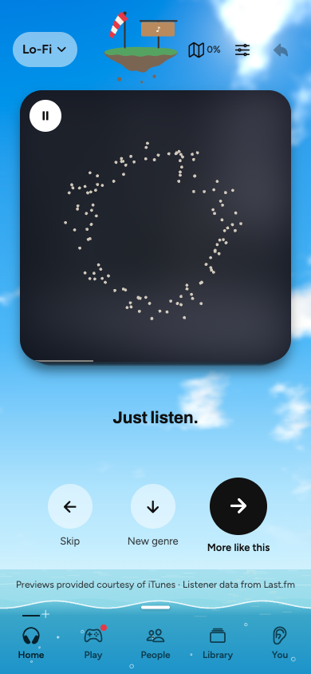
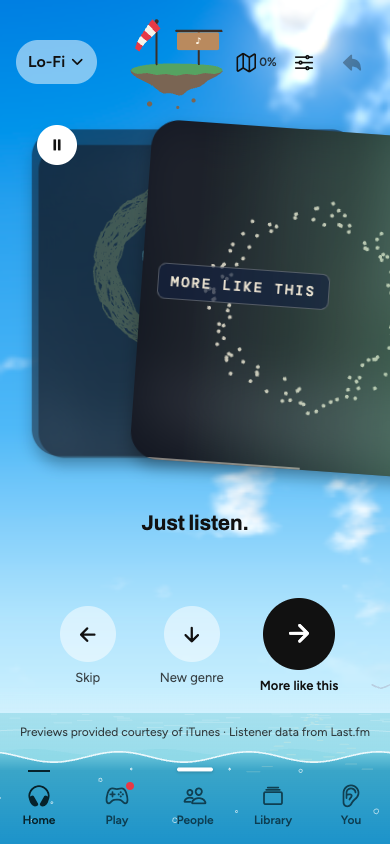
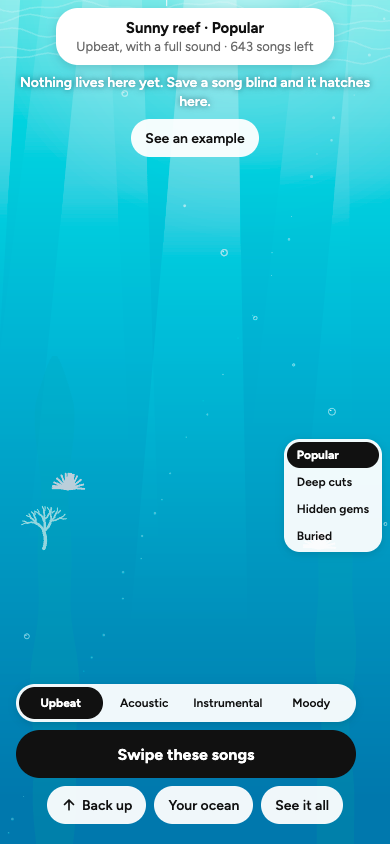

# Blindspot

Find music you would never search for, by hearing it before you know what it is.

Blindspot is a swipe app for iPhone and Android. It plays a 30-second preview with the artist and album art hidden, so you judge the song and not the name. Swipe right to reveal it and hear more like it, left to skip, or down to jump to a new genre.

<p>
  
  
  
</p>

## What's in it

- **Blind swiping:** while a song is hidden, the card draws its sound as moving particles.
- **Prints:** each song's data becomes its own piece of art, and your swipes build a personal piece over time.
- **The Ocean:** Home sits on real water you can dive under. Songs you save blind hatch down there.
- **Bottles:** songs you save blind float to strangers, who hear them blind too.
- **People:** meet other listeners through songs you both saved, not through photos.
- **The Dark Map:** music is laid out by how it sounds, and songs you've heard light up. The dark parts are your blind spots.
- **Play:** a Daily Drop and guessing games.
- **Import:** bring in a Spotify export or any song file, and the app tells you exactly what couldn't come in.

## How I made it

I built Blindspot with AI tools: Claude Code, Codex, and Gemini. I decide what to build and how it should feel, and I test it on a real phone. The AI tools write most of the code.

You can follow the whole process in the [changelog](changelog.md), the [feature log](features.md), the [bug log](bugs.md), and the [design specs](docs/superpowers/specs).

## Built with

- React Native, Expo, and TypeScript
- Skia for the drawings
- Supabase for Bottles and People
- iTunes for previews, Last.fm for listener counts, and Deezer and ReccoBeats for sound data

## Status

Blindspot is my class project at SMU, started in August 2026. Classmates test it through test builds, and it goes to a class showcase in December 2026. It isn't on the App Store yet.

## Run it yourself

Create a `.env.local` file with your own `EXPO_PUBLIC_LASTFM_API_KEY`, `EXPO_PUBLIC_SUPABASE_URL`, and `EXPO_PUBLIC_SUPABASE_ANON_KEY`. Then run:

```bash
npm install
npx expo start
```

## Credits

Previews provided courtesy of iTunes. Listener data from Last.fm.
