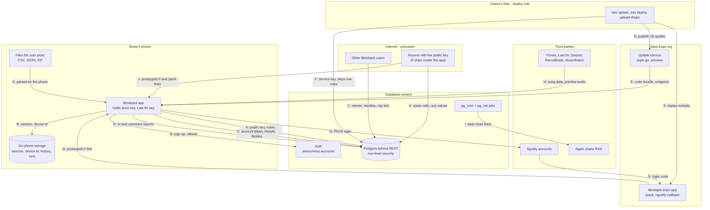

# Blindspot threat map

A map of **where** things could go wrong in Blindspot and **what to look for** at each place. It's a starting point, so there are no severity scores and no claim that it's complete. Severity rankings live in [`threat-model.md`](../threat-model.md); this map adds the path code takes to reach phones, which that file only touched on.

Made with Brent Brimhall's [`mapping-threats`](https://gist.github.com/zenbrent/9d167e49631688d1e03c97cf9069d8ff) method, which he shared in a class talk on 2026-11-19.

## Basis

- **Date:** 2026-11-20, against `main` at 72e1333. The fixes listed under Leads are on branch `security-pass`.
- **Read in full:** `app.json`, `eas.json`, `.gitignore`, `supabase/comments.sql`, `supabase/ai-reports.sql`, `threat-model.md`.
- **Read in part:** `lib/supabase.ts` (all writers), `lib/auth.ts` (session create and refresh), `lib/discovery-storage.ts` (`loadDeviceId`), `lib/human-check-api.ts`, `app/comments.tsx`, `lib/spotify-api.ts` (login), `app/ocean-lab.tsx`, `app/print-lab.tsx`, `supabase/setup.sql`, `supabase/charts-auto.sql`, `supabase/charts-lockdown.sql`, `supabase/decoded-votes.sql`, `scripts/upload-drops.ts`, `scripts/verify-twins.sh`.
- **Only searched:** every `EXPO_PUBLIC_` and `SUPABASE_SERVICE_KEY` use, every route that reads link parameters (`useLocalSearchParams`), tracked files with secret-like names, `.github/`, and which Desktop worktrees hold a real `.env.local` (key names counted, values never read).
- **Not done:** the app wasn't run, no request was sent to Supabase or any other service, and no APK was opened. People, Twins and Bottles SQL weren't re-read; those rows cite `threat-model.md`, which quotes their lines. Its live read-only check (2026-11-18) is the latest evidence of what the real database refuses.

## The system

Blindspot is an Expo app that testers run in Expo Go or as an Android APK. It plays song previews from iTunes, and most of its music data is bundled. A Supabase project holds the shared parts: Daily Drop votes, comments, crowd reports, People, Bottles and chart snapshots. Phones reach it over REST with the public key, or with an invisible anonymous account. New JavaScript reaches phones as over-the-air updates from an Expo project owned by the class org. A small website on EAS Hosting serves Blind Pack links and the Spotify login return. The owner's Mac is how code and Daily Drops get to production: it publishes updates, deploys the site, and uploads drops with the service key.

| Part | Status | Shown by |
|---|---|---|
| Phone app (Expo Go + APK) | deployed | `app.json` `updates.url`, `eas.json` `preview` channel |
| Supabase tables, functions, auth | deployed | `lib/supabase.ts`, `lib/auth.ts`, `supabase/*.sql` |
| Supabase scheduled chart fetch | deployed | `supabase/charts-auto.sql:59-60` `cron.schedule` |
| Website `blindspot.expo.app` | deployed | `CLAUDE.md` (Blind Pack), `app/pack.tsx`, `app/spotify-callback.tsx` |
| `scripts/upload-drops.ts` on the owner's Mac | deploy role | uses `SUPABASE_SERVICE_KEY` (line 6) |
| Other `scripts/` (catalogs, sound index, maps) | local-only | build bundled files; no service key |
| `scripts/verify-twins.sh` | local-only | public key only (line 6) |
| Taste Twins tables | deployed, kept for sync | `app/_layout.tsx:67` `startTwinSync` |
| `lib/taste-test.ts` quiz | dormant | `CLAUDE.md`: not imported by any route |
| GitHub workflows | none | no `.github/` folder |

## Diagram

Each arrow's letter matches an area below. The parts with no arrows are under area L.

**No arrows (area L):** the GitHub repo (public), the Supabase dashboard account, the Spotify developer dashboard, the Last.fm API account, membership of the Expo org `smu-c3-mobile-fall-26`, and the Apple ID whose iCloud Drive syncs the Desktop.

## Assets

| Asset | Where it lives | Why someone would want it |
|---|---|---|
| People profiles, handles, hearts, waves | Supabase `twin_*` and People tables | Reach a real person off the app; Dating plus a self-declared age (threat-model.md TM-001) |
| Bottle place | Supabase Bottles tables, city text plus coordinates rounded to 0.5° | Rough location of whoever saved a song |
| The update channel | Expo project `93a021d9…` in the class org | Whoever publishes runs code on every tester's phone |
| `SUPABASE_SERVICE_KEY` | `.env.local` on the owner's Mac: 5 real copies across Desktop folders, which iCloud Drive syncs (key name only, value unread) | Reads and writes every table, skipping row rules |
| Crowd signals | `ai_reports`, `comment_reports`, `votes`, `guesses`, `decoded_votes` | Hide a real artist from everyone, silence comments, skew results |
| Session token and device id | AsyncStorage `supabase-session-v1`, the device id key | The device id can reclaim a People profile (`claim_twin_profile`) |
| Run routes and listening history | AsyncStorage only, never uploaded | Location history if a phone is lost |
| Supabase and Last.fm quota | Free tiers | Burning them breaks People, comments and listener counts during a demo |

## Actors and trust boundaries

Actors, from most capable to least:

1. **The owner** (deploy role): the service key, the Supabase dashboard, publishing to the Expo project, deploying the site.
2. **Class Expo org members**: may be able to publish updates or deploy the site. Roles weren't checked.
3. **Anyone with the public key**: pulls it out of the APK or bundle and calls REST and Auth directly.
4. **Signed-in users** (anonymous accounts): People, Bottles, Twins functions.
5. **Other apps on the phone**: can open `prototype0://` links.

| Boundary | What enforces it |
|---|---|
| Internet → Supabase tables | Row-level security per table; column grant hides `comments.device_id` (`setup.sql:189-190`) |
| Account → other accounts' data | Security-definer functions that check `auth.uid()` (threat-model.md, People and Bottles rows) |
| Class org → phones | Expo account login only; no update code signing in `app.json` |
| Owner's Mac → database | Whoever holds `SUPABASE_SERVICE_KEY` |
| Spotify → site → app | PKCE S256, a random nonce in `state`, a return-link allow-list (`lib/spotify-api.ts:67-71`, `lib/spotify.ts` `safeReturnUrl`) |
| Database → Apple RSS | Fixed URL in `request_chart_feeds`, execute revoked from `anon` and `authenticated` (`charts-auto.sql:52-55`) |

## Areas

### A. Public-key reads and writes

Files: `lib/supabase.ts`, `lib/drop-sync.ts`, `supabase/setup.sql`, `supabase/comments.sql`, `supabase/decoded-votes.sql`.

| Look for | STRIDE |
|---|---|
| `votes` and `guesses` take any `device_id` for a recent day (`setup.sql:28`, `:48`); one caller can add as many voters as it can make up ids | S, T |
| `comments` insert is open to `anon` with a free `name` (1–30 chars), so anyone can post as "Professor" or a classmate's name, with no rate limit | S, R |
| A comment body or name holding a phone number or address stays readable through `comments?select=...` until three reports hide it | I |
| `decoded_votes` has no device id at all, so its counts can be stuffed; the app never reads `decoded_vote_counts`, so only the owner's own numbers would be off | T |
| Insert floods filling the free tier while classes or the Dec 3 showcase are running | D |

### B. Anonymous accounts and what the phone keeps

Files: `lib/auth.ts`, `lib/discovery-storage.ts`.

| Look for | STRIDE |
|---|---|
| Every reinstall makes a new account and a new device id, so per-account limits only hold as well as Supabase's per-IP sign-up limit does | S, D |
| `supabase-session-v1` and the device id sit in unencrypted AsyncStorage (threat-model.md TM-007) | I |
| `loadDeviceId` made ids with `Math.random`; an id reclaims a whole People profile through `claim_twin_profile` (TM-005) | S, E |

### C. Signed-in features: People, Twins, Bottles

Files: `supabase/people.sql`, `supabase/twins.sql`, `supabase/twins-fixes.sql`, `supabase/bottles.sql`, `lib/people-api.ts`, `lib/bottles-api.ts`, `app/person.tsx`.

| Look for | STRIDE |
|---|---|
| The adult flag is self-declared and stays editable (`twins.sql:56`, TM-001); reinstalling gets around an "under 18" hide | S, E |
| `twin_handle` and `person_songs` only answer after a mutual wave between two adults; check any new function keeps that rule | I |
| A bottle's city is text the phone sends; strangers see it, so it can carry anything that passes `bottle_clean_place` | I, T |
| Strangers' names, handles and city text arrive as untrusted strings; `handleUrl` (`lib/twins.ts:69`) builds links only from a fixed platform list | T |

### D. Crowd reports

Files: `supabase/ai-reports.sql`, `supabase/comments.sql`, `lib/supabase.ts`, `lib/human-check-api.ts`, `app/comments.tsx`.

| Look for | STRIDE |
|---|---|
| `ai_reports` and `comment_reports` took any `device_id` from the public key, so three made-up ids hid a real artist from every phone on the default "Hide AI music" (TM-002) | S, T, D |
| Three reports hide a comment automatically, with no owner review | T, R |
| `ai_reported` is readable by anyone; check it never grows a column that shows who reported | I |

### E. Code delivery to phones

Files: `app.json` (`owner`, `updates.url`, `runtimeVersion`), `eas.json`.

| Look for | STRIDE |
|---|---|
| The project is owned by the class org `smu-c3-mobile-fall-26`, not the owner's own account, so anyone with publish rights there can push JS to channel `preview` (TM-004) | T, E |
| No update code signing is set in `app.json`, so phones trust any update the Expo project serves | T |
| The same org controls `blindspot.expo.app`, the page that receives Spotify login codes | T, S |
| Expo Go group links pin one update, but the APK follows the `preview` branch and takes whatever comes next | T |

### F. The owner's Mac as the path to production

Files: `.gitignore`, `scripts/upload-drops.ts`, `.env.local` (key names only).

| Look for | STRIDE |
|---|---|
| `.env.local` holds `SUPABASE_SERVICE_KEY` next to the public keys; it's ignored by git (`.gitignore:34`) and never tracked. But it's a real file in `prototype0`, `-coral`, `-new-home`, `-p5` and `-rewind` on the Desktop (symlinks in the others), and the Desktop is in iCloud Drive, so the Apple ID holds the key too | I, E |
| EAS builds skip gitignored files unless a `.easignore` says otherwise; one that un-ignores `.env.local` would upload the service key to the build servers | I |
| `upload-drops` writes `drops` with the service key, which skips row rules, so a bad file there goes straight to every phone's Daily Drop | T |
| The Supabase SQL editor runs as the owner; any SQL pasted there skips every rule in this map | E |

### G. Spotify login

Files: `lib/spotify-api.ts`, `lib/spotify.ts`, `app/spotify-callback.tsx`, `app/spotify-auth.tsx`.

| Look for | STRIDE |
|---|---|
| `SPOTIFY_CLIENT_ID` is in source (`lib/spotify.ts:18`); that's fine with PKCE, but the redirect allow-list lives only in Spotify's dashboard | S |
| Another Android app can claim `prototype0://` and receive the login code; the verifier never leaves memory, so the code alone is useless (TM-009) | I |
| The access token must stay in memory only (`lib/spotify-api.ts:90`) | I |

### H. Third-party music data

Files: `lib/discovery.ts`, `lib/sound-lookup.ts`, `lib/human-check-api.ts`, `lib/bottle-rows.ts`.

| Look for | STRIDE |
|---|---|
| iTunes, Last.fm, Deezer, ReccoBeats and MusicBrainz responses are drawn as text; check nothing renders them as HTML on the website | T |
| Bottles resolve a song from its track id, never a server URL (`CLAUDE.md`, Bottles); keep it that way for any new shared-song feature | T |
| `EXPO_PUBLIC_LASTFM_API_KEY` ships in the bundle, so anyone can spend its quota (TM-006) | D |

### I. The database's own outbound fetch

Files: `supabase/charts-auto.sql`, `supabase/charts-lockdown.sql`, `lib/charts-api.ts`.

| Look for | STRIDE |
|---|---|
| `request_chart_feeds` and `store_chart_feeds` are security-definer functions; execute is revoked from `anon` and `authenticated` (`charts-auto.sql:52-55`), so check new functions copy that | E |
| Snapshot rows come from Apple's RSS and reach phones through `chart_track_stats`; the app should treat them as untrusted text | T |
| Inserts and updates on `chart_snapshots` are revoked from the public roles (`charts-lockdown.sql:4`) | T |

### J. Links into the app

Files: the 13 routes that read link parameters: `app/art.tsx`, `charts.tsx`, `comments.tsx`, `coral.tsx`, `edition.tsx`, `ocean-lab.tsx`, `pack.tsx`, `person.tsx`, `run-reveal.tsx`, `sea.tsx`, `search.tsx`, `song.tsx`, `songs.tsx`.

| Look for | STRIDE |
|---|---|
| A route that acts on open (saves, sends, waves) from a link alone, with no tap from the user | T, E |
| `app/ocean-lab.tsx` has no `__DEV__` gate, unlike `app/print-lab.tsx:36`; it only draws made-up data, but it's reachable in release builds | I |
| `/pack` shows a sender name from the link; check it's drawn as text and the song ids parse as integers (`lib/blind-pack.ts` `parsePack`) | S, T |

### K. Files the user picks

Files: `lib/import-file.ts`, `lib/spotify-file.ts`.

| Look for | STRIDE |
|---|---|
| ZIP unpacking stays inside the 100 MB cap and the unpacked-size checks in `filesFromZip` | D |
| Nothing from an imported file gets uploaded; Spotify's Developer Policy and the app's own rule both depend on it | I |

### L. Platform accounts (no arrows)

| Look for | STRIDE |
|---|---|
| 2FA on the Expo, Supabase, GitHub and Spotify developer accounts: each one can change code, data or login for every tester | S, E |
| The Apple ID: iCloud Drive syncs the Desktop, so it holds every `.env.local` copy (area F) | I |
| Who else is in the Expo org and with what role | E |
| The GitHub repo is public, so everything in git history is public; keys were checked once on 2026-11-18 (threat-model.md) | I |

## Leads

Things noticed while reading. Each one is unverified unless it says otherwise.

1. **Area D, crowd reports can be faked. Confirmed and fixed on `security-pass`.** `supabase/crowd-sim.mjs` runs today's rules in PGlite and shows three made-up device ids hiding an artist and a comment. `supabase/crowd-reports.sql` makes each report come from an account, as itself; the app now sends reports signed in (`reportAsAccount` in `lib/supabase.ts`). The sim passes 19 of 19. **The SQL hasn't been run on the live database yet.**
2. **Area B, guessable device ids. Fixed on `security-pass` for new installs.** `loadDeviceId` now uses `expo-crypto`'s `randomUUID`, and falls back to the old generator only on a build without the module. Existing ids don't change.
3. **The old model's TM-008 looks wrong.** It says the APK asks for microphone access. `app.json` `android.blockedPermissions` has listed `RECORD_AUDIO` since commit e0f2e66 (2026-09-01), before that model was written. To confirm, check the built APK's manifest. Both permission lists also repeat their entries, which is worth tidying.
4. **Area F, the service key is in iCloud.** Five Desktop folders hold a real `.env.local` with `SUPABASE_SERVICE_KEY`, and the Desktop syncs to iCloud Drive. The four old worktree copies (`-coral`, `-new-home`, `-p5`, `-rewind`) look stale. Deleting them, or swapping them for symlinks, cuts the copies to one, and 2FA on the Apple ID guards the rest. Not changed here.
5. **Area J:** `app/ocean-lab.tsx` is reachable in release builds (see the area table).
6. **Area A:** comments still take any name with no rate limit (TM-003), and votes take any device id. Not changed here.

**Checked, and it fails closed:**
- `.env.local` is gitignored and was never tracked. No tracked file has a secret-like name, and there are no CI workflows that could leak one.
- Only `EXPO_PUBLIC_` values get built into the app. `SUPABASE_SERVICE_KEY` is read only by `scripts/upload-drops.ts`.
- The chart job functions can't be called with the public key (`charts-auto.sql:52-55`).
- `comments.device_id` is hidden from the public key (`setup.sql:189-190`).
- `app/print-lab.tsx` returns nothing outside development.
- With the fix, an account can't report under a made-up id or under another account, and reporting twice counts once (`crowd-sim.mjs`).

## Unknowns that change the model

| Question | Area |
|---|---|
| Who in `smu-c3-mobile-fall-26` can publish updates, start builds or deploy the site? | E |
| Is 2FA on for the owner's Expo, Supabase, GitHub, Spotify developer and Apple (iCloud) accounts? | E, F, L |
| What is the live per-IP limit on anonymous sign-ups? The crowd-report fix is only as strong as this. | B, D |
| Did any EAS build ever upload `.env.local`? Project notes mention an untracked `.easignore` used for a Prototype 3 rebuild on 2026-10-01. If it un-ignored that file, rotate the service key. | F |
| Which variables are stored in EAS's `preview` environment, and is the service key one of them? | F |
| Does the live database match `supabase/*.sql`? It was spot-checked on 2026-11-18, but not every function. | A–D, I |
| Which redirect links does the Spotify dashboard allow? | G |
| Are Supabase usage or abuse alerts set up? | A, D |
| Does the APK's merged manifest really drop `RECORD_AUDIO`? | E |

## Revisit when

- Any `supabase/*.sql` runs in the dashboard, or a table or policy changes.
- A new native module means a new APK, or `app.json` permissions change.
- The project moves out of the class org, or ships to an app store.
- GitHub Actions or any other automation gets deploy rights.
- People gets photos or chat, or comments move behind accounts.
- The website serves more than `/pack` and `/spotify-callback`.
- A new outside service is added, on the phone or inside the database.
