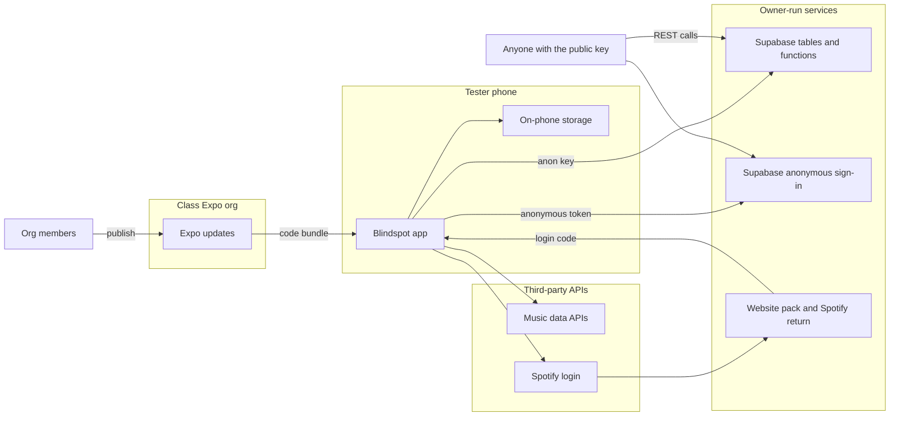

# Blindspot threat model

Made with the `security-threat-model` skill (openai/skills, installed in `.claude/skills/security-threat-model`) on 2026-11-18, against `main` at db788e2. Assessment only: no app code was changed. It identifies risks to look into; it does not certify that the app is secure.

## Executive summary

Blindspot is an Expo app with a small Supabase backend. Its accounts are anonymous: there are no emails, passwords or real names beyond a first name someone types into People. **No urgent issue was found that puts classmates', the professor's or showcase visitors' information at risk.** The app never asks for an email (no `email` field exists anywhere in `app/`, `components/`, `hooks/` or `lib/`). Every table that holds personal data refuses the app's public key: profiles, handles, hearts, waves, bottles and People swipes all returned `401 / 42501` in a live check on 2026-11-18. No secret keys are in the repo or its git history. The top risk themes are about safety and trust, not data leaks:

1. **People** pairs adults for Dating on a self-declared age and swaps social handles after a mutual wave (TM-001).
2. **Crowd signals** (AI reports, comment reports, Daily Drop votes) count client-chosen device ids, so one person can forge "three different phones" (TM-002).
3. **Public free text** (song comments, a bottle's place name) has no rate limit or filter (TM-003).
4. **Updates** reach the Android test build from an Expo project owned by the shared class org (TM-004).

For today's use (classmates, the professor, a few adult testers, and visitors trying it on the owner's phone), none of these rank above medium. TM-001 to TM-004 should be fixed before any public release.

## Scope and assumptions

**In scope (runtime):** `app/`, `components/`, `hooks/`, `lib/` (the app), `supabase/*.sql` (the server's tables, row rules and functions), the public website routes `app/pack.tsx` and `app/spotify-callback.tsx`, and distribution config in `app.json` / `eas.json`.

**Out of scope:** `scripts/` (developer-only data pipelines, including the only use of `SUPABASE_SERVICE_KEY`, which never ships: `CLAUDE.md`, "used by the scripts only"), tests and `*-sim.mjs` checks, `docs/`, third-party npm dependencies (no dependency audit was run), Supabase dashboard settings that aren't in the repo (auth rate limits, backups), and the outside music services themselves (iTunes, Last.fm, Deezer, ReccoBeats, MusicBrainz, Spotify).

**Context confirmed by the owner (2026-11-18):**
- Users are classmates, the professor and a few testers. At the Dec 3 showcase, visitors mostly try it on the owner's phone.
- It stays a class project, with no App Store or Google Play release planned. Distribution is Expo Go links and an EAS-built APK.
- The People tab stays on as it is, with Friends, Dating and Either.

**Assumptions (not verified):**
- The live database matches `supabase/*.sql`. This was spot-checked live for 17 tables and views (below), but not every function.
- Members of the Expo org `smu-c3-mobile-fall-26` may have permission to publish updates to this project. Roles weren't checked.
- Supabase's default per-IP limits on anonymous sign-ups are on.

**Open questions that would change the ranking:**
- Who in the class Expo org can publish updates or builds for this project? This moves TM-004.
- Will anyone under 18 ever get the app, for example a sibling or a showcase visitor who scans a QR code? This moves TM-001.
- Are Supabase usage or abuse alerts set up? This moves TM-002, TM-003 and TM-006.

## System model

### Primary components

- **Phone app** (Expo Router, React Native): five tabs (Home, Play, People, Library, You). Most music comes from bundled catalogs (`assets/catalogs/`) plus live iTunes lookups (`lib/discovery.ts`).
- **On-phone storage** (AsyncStorage, not encrypted): history, saves, the Supabase session (`lib/auth.ts`, key `supabase-session-v1`), a random device id (`lib/discovery-storage.ts:349` `loadDeviceId`), Run GPS routes (`lib/run-storage.ts`, never uploaded), and the in-app log (`lib/app-log-app.ts`).
- **Supabase** (Postgres + REST + anonymous auth), reached over HTTPS with the public anon key (`lib/supabase.ts`, `lib/twins-api.ts`, `lib/people-api.ts`, `lib/bottles-api.ts`):
  - public-key tables with insert-only rules: `votes`, `guesses`, `comments`, `comment_reports`, `vibes`, `ai_reports`, `decoded_votes` (`supabase/setup.sql`, `comments.sql`, `ai-reports.sql`);
  - signed-in features behind security-definer functions: People / Twins (`supabase/twins.sql`, `twins-fixes.sql`, `people.sql`) and Bottles (`supabase/bottles.sql`).
- **Website** `blindspot.expo.app` (EAS Hosting): it only serves `/pack` (a shared song list) and `/spotify-callback` (forwards Spotify's login code to the app).
- **Expo update service**: OTA JavaScript updates on branches `expo-go` and `preview`. The APK follows channel `preview` (`app.json` `updates.url`, owner `smu-c3-mobile-fall-26`).
- **Third-party APIs:** iTunes, Last.fm (key bundled as `EXPO_PUBLIC_LASTFM_API_KEY`), Deezer → ReccoBeats, MusicBrainz, and Spotify login with PKCE (`lib/spotify-api.ts`).

### Data flows and trust boundaries

- **App → Supabase REST, public-key tables:** device id, Daily Drop votes and guesses, comment name and text, vibe words, AI reports, Taste Decoded votes. HTTPS. Row-level security allows insert only. Reads go through aggregate views (`drop_results`, `vibe_counts`, `ai_reported`) and a column-limited grant on `comments` that leaves out `device_id` (`supabase/setup.sql:188-190`). Validation: length checks in the table definitions. **No authentication or rate limit**, and the device id is whatever the caller sends.
- **App → Supabase Auth:** anonymous sign-up and token refresh (`lib/auth.ts` `authCall('signup', {})`). HTTPS. The tokens are bearer tokens.
- **App → Supabase functions, signed in (People, Twins, Bottles):** first name, intent, handle and platform, the adult flag, hearted track ids, waves, blocks and reports, plus a bottle's place (city text, latitude and longitude). HTTPS with the user's JWT. Base tables are revoked from `anon` and `authenticated` (`supabase/bottles.sql:62`, `people.sql:55`, `twins.sql:52-56`). Functions check `auth.uid()` and membership (`people_member`), blocks, the adult flag and mutual waves. Coordinates are rounded to 0.5° on the server (`bottle_clean_place`). There are caps: 20 bottles a day (`float_bottle`) and 10 waves a day (`people_settings.waves_per_day`).
- **Other users → you, through Supabase:** a person's name, taste print and shared songs (`my_people`, `person_songs`), a bottle's city text, comments. These are untrusted strings, drawn as React Native text. Contact links are built only from a fixed platform list plus the handle (`lib/twins.ts:69` `handleUrl`).
- **App ↔ Spotify ↔ website:** an authorization code. HTTPS plus a custom scheme. Protections: PKCE (S256, 64 random bytes), a random nonce in `state` that's checked on return (`lib/spotify-api.ts:68-82`), an allow-list of return links (`lib/spotify.ts:119` `safeReturnUrl`), and the access token kept only in memory (`lib/spotify-api.ts:90`).
- **Expo update service → app:** the whole JavaScript bundle. HTTPS. Protection is Expo account access. No update code signing is configured in `app.json`.
- **Files the user picks → app:** CSV, JSON or ZIP. Parsed on the phone (`lib/import-file.ts`, `lib/spotify-file.ts`). Limits: a 100 MB cap and unpacked-size checks (`filesFromZip`). It never throws, and nothing is uploaded.
- **Anyone on the internet → Supabase:** the anon key is extractable from the public APK or bundle, so anyone can make the same REST calls the app makes. The live check confirmed which reads are refused.

#### Diagram

## Assets and security objectives

| Asset | Why it matters | Security objective (C/I/A) |
|---|---|---|
| People profiles: first name, Friends/Dating intent, adult flag, handle and platform | Leads to a real person off the app; Dating plus age is a safety issue | C, I |
| Hearts, waves, blocks and reports (`twin_likes`, `twin_waves`, `twin_blocks`, `twin_reports`) | Reveal taste and who wants to meet whom; blocks and reports are safety controls | C, I |
| Bottle place (city, country, rounded coordinates) | Rough location of the person who saved a song | C |
| Supabase session tokens and device id on the phone | The device id can reclaim a People profile (`claim_twin_profile`) | C |
| Crowd signals: AI reports, comment reports, Daily Drop votes and guesses, vibes | Hide artists from everyone's feed, hide comments, set game results | I |
| Song comments | Public text tied to a song; could carry abuse or someone's personal info | I, C |
| JavaScript bundle and update channel | Whoever controls it runs code on every tester's phone | I |
| Bundled API keys (Supabase anon, Last.fm) and Supabase free-tier quota | Abuse can take features down during class or the showcase | A |
| Run GPS routes and listening history (local only) | Location history if a phone is lost or backed up | C |

## Attacker model

### Capabilities
- Install the app from the public Expo Go link or APK (posted in class threads), pull the anon key and Last.fm key out of the bundle, and call Supabase REST and RPC endpoints directly with any values.
- Create anonymous Supabase accounts, as many as the auth rate limits allow, and get a new account and device id just by reinstalling.
- Join People, answer the age question with anything, pick Dating, heart songs, and wave.
- Write any text into fields the server takes as text: comment name and body, a bottle's city name, a Blind Pack `from` name.
- As a member of the class Expo org (assumption), possibly publish an update.

### Non-capabilities
- Can't read profiles, handles, hearts, waves, bottles, People swipes or device ids with the public key. Confirmed live: those requests returned `401 / 42501`, and the insert-only tables returned `[]`.
- Can't see another person's handle without a mutual wave between two accounts that both said 18+ (`twin_handle`, `person_songs`).
- Can't get any emails, passwords or real identities: none are collected.
- Can't use a stolen Spotify login code without the in-memory PKCE verifier.
- No server-side code runs on uploaded files, and there's no admin panel or service key in the app.

## Entry points and attack surfaces

| Surface | How reached | Trust boundary | Notes | Evidence (repo path / symbol) |
|---|---|---|---|---|
| Insert-only REST tables | HTTPS + anon key | Internet → Supabase | Client-chosen `device_id`; no auth or rate limit | `lib/supabase.ts:26` `sendVotes`, `:106` `postComment`, `:122` `reportAiArtist`; `supabase/ai-reports.sql` |
| Comment reads | HTTPS + anon key | Supabase → anyone | Column grant hides `device_id` (live 401) | `supabase/setup.sql:188-190` |
| Anonymous sign-up | HTTPS | Internet → Supabase Auth | One account per install, unlimited installs | `lib/auth.ts` `load` |
| People and Twins functions | Signed-in RPC | App → Supabase | Self-declared `adult`; handle only after mutual wave | `supabase/people.sql` `people_member`, `person_songs`, `people_can_wave`; `supabase/twins.sql:169` `twin_handle` |
| Profile claim | Signed-in RPC | App → Supabase | Device id moves a whole profile to the caller | `supabase/twins-fixes.sql` `claim_twin_profile`; `lib/twins-api.ts:77` |
| Bottles functions | Signed-in RPC | App → Supabase → strangers | City text shown to strangers; coordinates rounded | `supabase/bottles.sql` `float_bottle`, `bottle_clean_place` |
| Website `/pack` | Public URL | Internet → website | `from` name shown as text; ids parsed as integers | `lib/blind-pack.ts` `parsePack`; `app/pack.tsx` |
| Website `/spotify-callback` | Public URL | Spotify → website → app | Forwards only to allow-listed app links | `lib/spotify.ts:128` `callbackTarget`, `:119` `safeReturnUrl` |
| Custom-scheme deep links | `prototype0://…` | Other apps → app | Opens routes with parameters | `app.json` `scheme`; `app/` routes |
| File import | System file picker | Phone files → parser | Local only; size checks on ZIPs | `lib/import-file.ts` `readImport`; `lib/spotify-file.ts:170` `filesFromZip` |
| OTA updates | Expo update service | Class Expo org → phones | No update code signing | `app.json` `owner`, `updates.url` |
| App log sharing | Tune → More → Log → Share | Phone → whoever receives it | No tokens or device id are logged | `lib/app-log-app.ts`, `app/log.tsx` |

## Top abuse paths

1. **Minor in Dating.** A 15-year-old installs from a shared link → answers the age question as 18+ → picks Dating → hearts songs until in tune with an adult → both wave → handles swap (`twin_handle`) → contact moves to Instagram or Snapchat, where the app can't help. If someone reports "might be under 18", the profile hides at once, but reinstalling makes a fresh anonymous account that isn't hidden.
2. **Hide a real artist from everyone.** Pull the anon key from the APK → insert three `ai_reports` rows for one artist with three made-up device ids → `ai_reported` now lists the artist → every phone on the default "Hide AI music" skips them in discovery (`lib/human-check-api.ts` `knownAi` → `hideFromDiscovery`).
3. **Silence or flood comments.** Send three `comment_reports` with made-up device ids → any comment hides itself. Or post hundreds of comments under any name ("Professor", a classmate's name), since nothing limits the rate.
4. **Post someone's personal info.** Put a classmate's phone number or address in a song comment or a bottle's city text → it shows to everyone who reveals that song or gets that bottle, and the text stays readable through the public REST endpoint until three reports hide it.
5. **Push code to testers.** An org member's Expo account (shared or taken over) publishes an update to branch `preview` → every APK tester runs it on the next open → it reads the on-phone session, history and Run routes, and can use any location permission already granted.
6. **Take over a People profile.** Get someone's device id (it sits in plain on-phone storage and goes out with every vote and comment) → sign in fresh → call `claim_twin_profile(device)` → inherit their hearts, waves and mutual matches, including handles their matches shared.
7. **Break features during the showcase.** Script anonymous sign-ups and inserts → fill the Supabase free tier, or burn through the bundled Last.fm key's quota → listener counts, People and comments fail while the demo is running. Home keeps working from the bundled catalogs.

## Threat model table

| Threat ID | Threat source | Prerequisites | Threat action | Impact | Impacted assets | Existing controls (evidence) | Gaps | Recommended mitigations | Detection ideas | Likelihood | Impact severity | Priority |
|---|---|---|---|---|---|---|---|---|---|---|---|---|
| TM-001 | Any installer, including a minor or an adult looking for minors | Install from a public link; say 18+ | Join Dating on a false age, match, swap handles, take contact off the app | Real-world harm to a minor; legal and app-store exposure | People profiles, handles | Age question (`components/people/join-flow.tsx`); waves and handles need both adult (`people_member`, `twin_handle`); mutual wave; no photos or chat; names can't hold contact info (`twins-fixes.sql` `twin_name_no_contact`); "under 18" report hides at once (`people.sql:278`); block/report; 10 waves a day | Age is self-declared and editable (`grant update (… adult)` in `twins.sql:56`); reinstalling gets around a hide; no review of reports | For class use: keep as is and tell testers it's 18+. Before any release: drop Dating or put it behind a platform age signal (look into Apple's Declared Age Range and Google Play's Age Signals APIs); tie bans to more than an anonymous account; owner review queue for reports | Alert on any "under 18" report; count re-joins shortly after a hide | Low (adult classmates; visitors use the owner's phone) | High | medium (high before release) |
| TM-002 | Anyone with the public key | Extract the anon key from the bundle | Insert reports and votes with made-up device ids | Real artists hidden for everyone; comments silenced; Daily Drop results skewed | Crowd signals, comments | Insert-only RLS; one row per (item, device) primary key; only aggregates readable (`ai_reported`, `drop_results`) | `device_id` isn't tied to any account; no rate limit; the 3-report threshold counts ids, not people | Move these writes into signed-in RPCs keyed on `auth.uid()` (the anonymous accounts already exist); per-account daily caps; for AI reports, require that the reporter heard the song and add owner review before hiding | Log report bursts per artist or comment; alert when `ai_reported` gains a row | Medium (trivial to do, little motive) | Medium | medium |
| TM-003 | Any installer or REST caller | None | Post abusive text, someone's personal info, or impersonate a name in comments; write any city name on a bottle | Harassment; a classmate's info shown to others | Comments, bottle places | Length checks (`comments.sql`, `bottle_clean_place`); 3-report hide; comments only after a reveal; text drawn as plain text | Anonymous, no rate limit, no contact or profanity filter; names free; city is client text, not checked against the geocode | Reuse `CONTACT_PATTERN` (`lib/twins.ts:81`) on comments server-side; per-account rate limit; owner alert on new comments; set the bottle city from a fixed list or time-zone region on the server; or switch comments off for the showcase | Notify the owner of each new comment; daily count | Low | Medium | low (medium before release) |
| TM-004 | Class Expo org member, or someone who takes over their account | Publish rights on this project (assumed, not checked) | Publish a JS update to branch `preview` | Arbitrary code on every APK tester's phone | Code bundle, everything on the phone | Expo account login; Expo Go group links pin one update | Shared org owns the project; no update code signing | Check org roles so only the owner can publish; turn on 2FA on the owner's Expo account; before any release, move the project to a personal account and turn on update code signing if the plan allows | Watch the project's update history before class days | Low | High | medium |
| TM-005 | Someone who learned a device id | The victim's device id (phone access or a server-side leak) and a fresh account | Call `claim_twin_profile(device)` | Inherits a People profile, waves and mutual handles | People profiles, handles | Device id never readable with the public key (live: `comments.device_id` 401; insert-only tables `[]`); not in the app log; claim only works for an account without a profile | One id is reused across 7 tables and acts as a password; made with `Math.random` (`lib/discovery-storage.ts:349`); no proof of the old session | Generate ids with `expo-crypto` `randomUUID`; use a separate claim secret, or retire the claim; send the device id only where it's needed | Log claims; alert on more than one claim per profile | Low | Medium | low |
| TM-006 | Anyone with the public key | None | Script sign-ups and inserts; reuse the bundled Last.fm key | Supabase quota used up or Last.fm key blocked during class or the showcase | Availability, quota | Per-account caps on bottles and waves; Home falls back to bundled catalogs; the keys are public by design | No caps on public-key inserts; no usage alerts (unverified) | Supabase usage alerts; insert caps (see TM-002); keep a spare Last.fm key | Supabase dashboard usage graphs | Low | Medium | low |
| TM-007 | Someone with the phone or its backup | An unlocked phone, or backup access | Read on-phone storage | Session token, device id, history and Run routes exposed | Local data | OS app sandbox; Spotify token never stored (`lib/spotify-api.ts:90`); Run data never uploaded; log leaves out secrets | AsyncStorage isn't encrypted | Keep the session and device id in `expo-secure-store`; add "delete my data" that also clears local stores | None | Low | Low | low |
| TM-008 | The app itself, through privacy trust | None | The Android APK declares microphone access it never uses | Testers see a mic permission; store review flags | User trust | Nothing records audio (no recorder in `app/`, `lib/`, `hooks/`, `components/`) | The `expo-audio` plugin default adds `RECORD_AUDIO` (`app.json` `android.permissions`) | Turn off the plugin's microphone options in `app.json` (check the SDK 58 `expo-audio` docs), then rebuild the APK | Review the permissions list in each APK | Medium | Low | low |
| TM-009 | Another app on an Android phone | Registers the `prototype0://` scheme | Intercepts the Spotify return link | Gets a login code it can't use | Spotify import | PKCE S256, random nonce check, return allow-list, token only in memory | Custom schemes can be claimed by other apps | None needed for class; use App Links / Universal Links before any release | None | Low | Low | low |

**What is confirmed and what is assumed:**
- TM-001: confirmed in code. TM-002 and TM-003: confirmed in code and in the SQL. The live check showed the tables accept public-key access by design, but no forged writes were sent.
- TM-004: depends on Expo org roles, which weren't checked.
- TM-005 to TM-009: confirmed in code. Nothing was tested on a phone.

## Criticality calibration

- **critical:** anyone on the internet can read People data or other personal data in bulk.
  - The public key could select `twin_profiles` or handles. The live check shows it can't.
  - A secret key (`SUPABASE_SERVICE_KEY`) ships in the bundle or the git history. The check found none.
- **high:** harm to a specific real person, or code running on testers' phones.
  - A minor matched in Dating with handles swapped (TM-001 after a public release).
  - A malicious OTA update (TM-004 if org members can publish).
  - Handles shown without a mutual wave.
- **medium:** trust or integrity harm to everyone, but no personal data exposed.
  - Forged AI reports hiding real artists (TM-002).
  - The TM-001 and TM-004 paths while users are only adult classmates.
- **low:** needs the victim's phone, an unlikely precondition, or limited harm.
  - Device-id profile claim (TM-005).
  - Unencrypted local storage (TM-007).
  - An unused mic permission (TM-008).

## Focus paths for security review

| Path | Why it matters | Related Threat IDs |
|---|---|---|
| `supabase/people.sql` | Membership, deck, waves and handle reveal for People | TM-001, TM-005 |
| `supabase/twins.sql` | Profile columns users may write (`adult`), `twin_handle`, leave flow | TM-001 |
| `supabase/twins-fixes.sql` | `claim_twin_profile`, report-hide trigger, name filter | TM-001, TM-005 |
| `components/people/join-flow.tsx` | Where age and intent are asked | TM-001 |
| `app/person.tsx` | Contact link opened from another user's handle | TM-001 |
| `supabase/ai-reports.sql` | 3 device ids hide an artist for everyone | TM-002 |
| `supabase/setup.sql` | Votes, guesses, comments, reports, vibes rules and grants | TM-002, TM-003 |
| `lib/supabase.ts` | Every public-key write and the device id it carries | TM-002, TM-003, TM-006 |
| `lib/human-check-api.ts` | How the AI-report list hides artists in the feed | TM-002 |
| `app/comments.tsx` | Comment posting and reporting UI | TM-003 |
| `supabase/bottles.sql` | `bottle_clean_place` and the city text strangers see | TM-003 |
| `lib/bottle-place.ts` | How the phone picks the city and coordinates | TM-003 |
| `lib/discovery-storage.ts` | `loadDeviceId` (Math.random) | TM-005 |
| `lib/auth.ts` | Anonymous session creation and storage | TM-005, TM-006, TM-007 |
| `app.json` | Org owner, update URL, Android permissions | TM-004, TM-008 |
| `eas.json` | Build profiles and the channel the APK follows | TM-004 |
| `lib/spotify.ts` | `callbackTarget` / `safeReturnUrl` redirect allow-list | TM-009 |
| `lib/spotify-api.ts` | PKCE, nonce check, token handling | TM-009 |
| `lib/spotify-file.ts` | ZIP unpacking limits for imported files | TM-007 |
| `app/pack.tsx` | Public website page that shows a sender name | TM-003 |

## Quality check

- Entry points covered: public-key tables, anonymous auth, People/Twins/Bottles functions, the profile claim, both website routes, deep links, file import, OTA updates, log sharing.
- Every trust boundary appears in at least one threat: Internet → Supabase (TM-002, TM-003, TM-006), App → Supabase signed in (TM-001, TM-005), Spotify → website → app (TM-009), Expo org → phones (TM-004), phone storage (TM-007, TM-008).
- Runtime vs dev: `scripts/` and the service key were set aside as developer-only, and the git history was checked for leaked keys (none found).
- The owner's answers (who uses it, no release, People stays on) are reflected in the likelihoods and priorities.
- Assumptions and open questions are listed under Scope and assumptions.

**Live check method (2026-11-18):** read-only `GET` requests to the project's REST API using only the public anon key that ships in the app, one row per table. No writes were sent and no data was changed.

## Plain-language terms

- **Anon key / public key:** the Supabase key built into the app. Anyone can pull it out of the app, so the database rules, not the key, are what keep data private.
- **RLS (row-level security):** database rules that decide which rows each caller may read or write.
- **Security-definer function:** a database function that runs with extra rights but checks who is calling (`auth.uid()`) before doing anything.
- **Bearer token:** a value that works for whoever holds it, like a ticket.
- **OTA update:** new app code downloaded the next time the app opens, without installing a new APK.
- **PKCE:** a login method where a stolen login code is useless without a secret that never leaves the phone.
- **Device id:** a random id the app makes once per install and stores on the phone.
